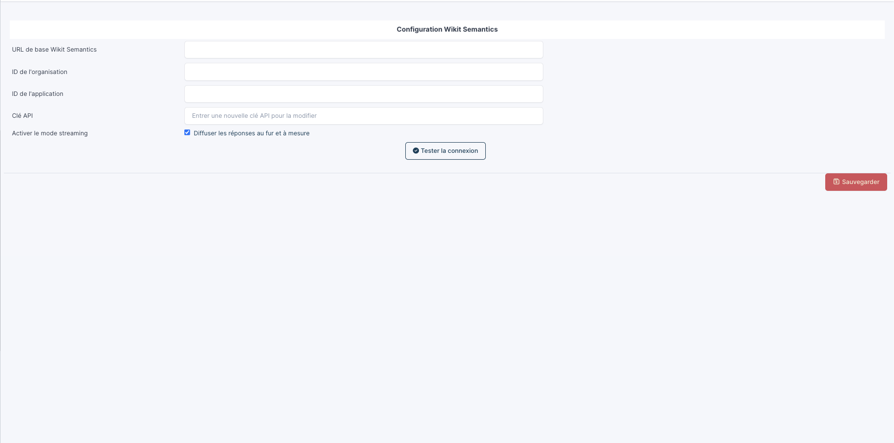
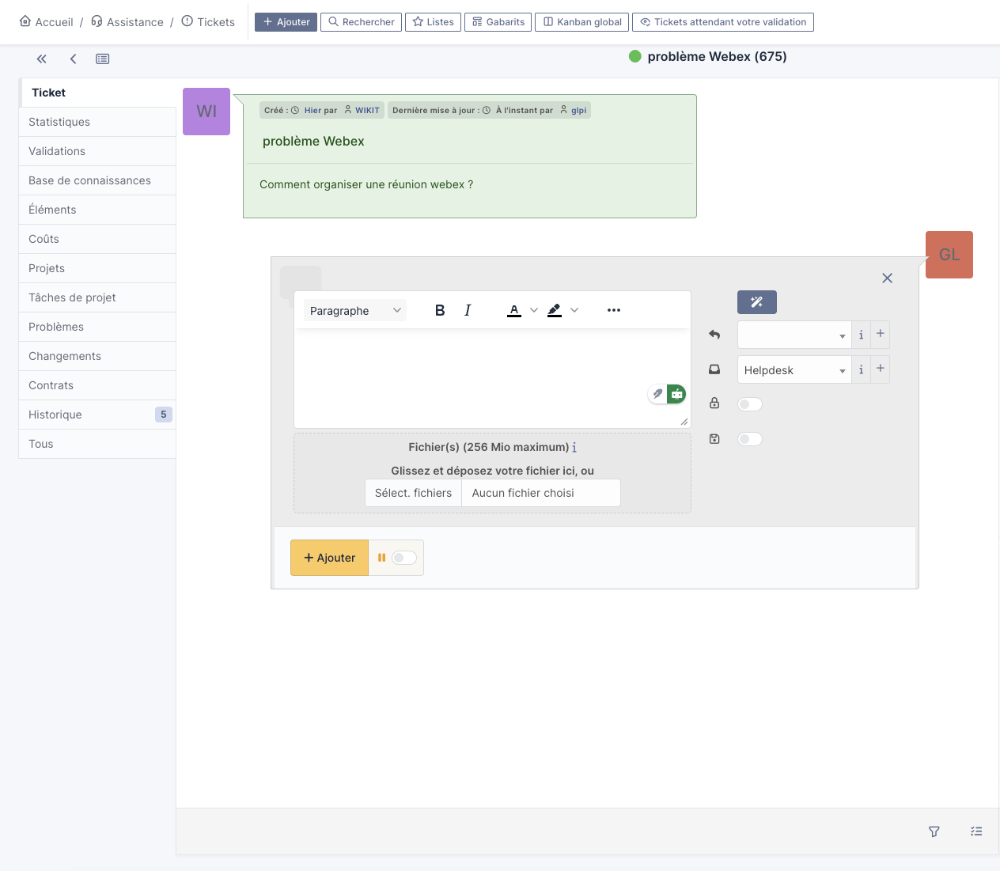
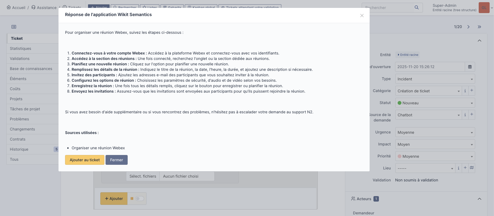

# Wikit Semantics Plugin for GLPI

## Overview

The **Wikit Semantics** plugin brings AI-powered semantic search and intelligent question-answering capabilities to your GLPI installation. By connecting your GLPI instance to the Wikit Semantics API, you can leverage advanced natural language processing to help users get answers quickly for tickets.

## What Does It Do?

This plugin enables users to find in natural language a answer to tickets, context-aware answers based on your organization's knowledge base. Instead of manually searching through tickets, documentation, or FAQ entries, users can simply find solutions and get immediate, relevant responses.

### Key Benefits

- **Faster Support Resolution**: Get instant answers to common questions without waiting for human intervention
- **Knowledge Base Enhancement**: Leverage AI to make your existing GLPI data more accessible and useful
- **Seamless Integration**: Works directly within your GLPI interface - no need to switch between applications

## Features

- Direct integration with Wikit Semantics API
- Secure API authentication with organization and application-level controls
- Easy configuration through GLPI's admin interface
- Connection testing to verify API setup
- Support for GLPI 10, 11 and 12 (one major plugin version per GLPI version)
- Real-time streaming responses (GLPI 11+)
- Multiple integration points: Followups, Solutions, and Tasks
- Knowledge Base articles generated from tickets, placed in the GLPI 12 knowledge base tree with a suggested parent article and a preview of the inherited visibility (GLPI 12+)
- Editor AI assistant (correction, formatting, translation): magic wand in the rich text editors, including the selection menu of the GLPI 12 knowledge base editor

## Screenshots

### Configuration Interface



### Integration with GLPI Forms





## Requirements

### Version Compatibility

| Plugin Version | GLPI Version | PHP Version | Branch | Status |
|---------------|--------------|-------------|--------|--------|
| 1.x.x | 10.0.0 - 10.9.99 | 8.0+ | `1.x` | Maintenance only |
| 2.x.x | 11.0.0 - 11.99.99 | 8.2+ | `2.x` | Maintenance |
| 3.x.x | 12.0.0 - 12.0.99 | 8.3+ | `3.x` | Active development |

**Important**:
- For **GLPI 10.x**, use version 1.x of this plugin
- For **GLPI 11.x**, use version 2.x of this plugin
- For **GLPI 12.x**, use version 3.x of this plugin
- Versions are not cross-compatible

### Network access (GLPI 12)

Calls to Wikit Semantics go through the GLPI HTTP client: the GLPI proxy configuration
(*Setup > General > System*) is applied, unless "Wikit Semantics" is selected in the proxy
exclusions of the same page.

GLPI 12 refuses server-side requests to private network addresses. If your Wikit Semantics
instance is reachable on a private network (self-hosted instance), allow the plugin in the
`config/local_define.php` file of GLPI, keeping the GLPI default values:

```php
<?php
define('GLPI_SERVERSIDE_URL_ALLOWED_PRIVATE_NETWORKS_CONTEXTS', [
    Agent::class,
    Auth::class,
    'GlpiPlugin\\Wikitsemantics\\Config',
]);
```

### Prerequisites

- Active Wikit Semantics account with:
  - API URL
  - Organization ID
  - Application ID
  - API Key

## Quick Setup
0. Download repository and rename folder wikitsemantics
1. Install the plugin in your GLPI plugins directory move folder wikitsemantics to plugins directory, should be something like that : /var/www/html/glpi/marketplace/
2. Activate the plugin from the GLPI interface
3. Navigate to the plugin configuration page
4. Enter your Wikit Semantics API credentials
5. Test the connection to verify everything is working
6. Start using AI-powered semantic search in your GLPI instance

## About Wikit Semantics

Wikit Semantics provides enterprise-grade AI solutions for intelligent information retrieval and knowledge management. Visit [Wikit](https://wikit.ai) for more information.

## Development

The plugin follows the [GLPI plugin guidelines](https://glpi-developer-documentation.readthedocs.io/en/master/plugins/index.html)
and the tooling of the [Teclib plugin template](https://github.com/pluginsGLPI/empty). The tools are provided by a GLPI 12
development checkout (`composer install` and `npm ci` in GLPI), with the plugin cloned in its `plugins/` directory:

```bash
../../vendor/bin/php-cs-fixer fix          # coding standard (PER-CS)
../../vendor/bin/rector process             # automated refactoring
../../vendor/bin/phpstan analyse            # static analysis (level max, existing issues in phpstan-baseline.neon)
../../vendor/bin/twigcs                     # Twig templates
../../node_modules/.bin/eslint .            # JavaScript
vendor/bin/licence-headers-check --fix     # licence headers (composer install in the plugin)
```

Unit tests use the GLPI test framework (PHPUnit, `Glpi\Tests\DbTestCase`) and a dedicated test database:

```bash
# In the GLPI directory, once
php bin/console database:install --env=testing --db-name=glpitests --db-user=root --db-password=xxxx
php bin/console plugin:install --env=testing -u glpi --force <plugin>
php bin/console plugin:activate --env=testing <plugin>

# In the plugin directory
composer install
../../vendor/bin/phpunit
```

The same checks run in the continuous integration (glpi-project/plugin-ci-workflows).

## Contributing

* Open a ticket for each bug/feature so it can be discussed
* Work on a new branch on your own fork
* Open a PR that will be reviewed by a developer

## License

This plugin is licensed under the Apache 2.0 License.

## Support

For issues, questions, or contributions, please visit our [GitHub repository](https://github.com/wikit-ai/GLPI-Semantics).

---


**Copyright**: © 2026 Wikit
