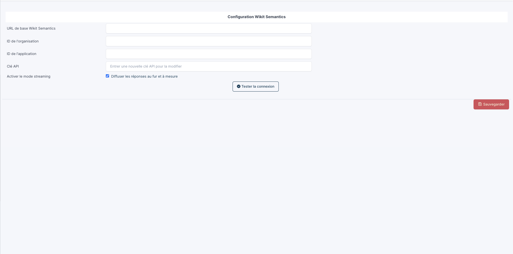
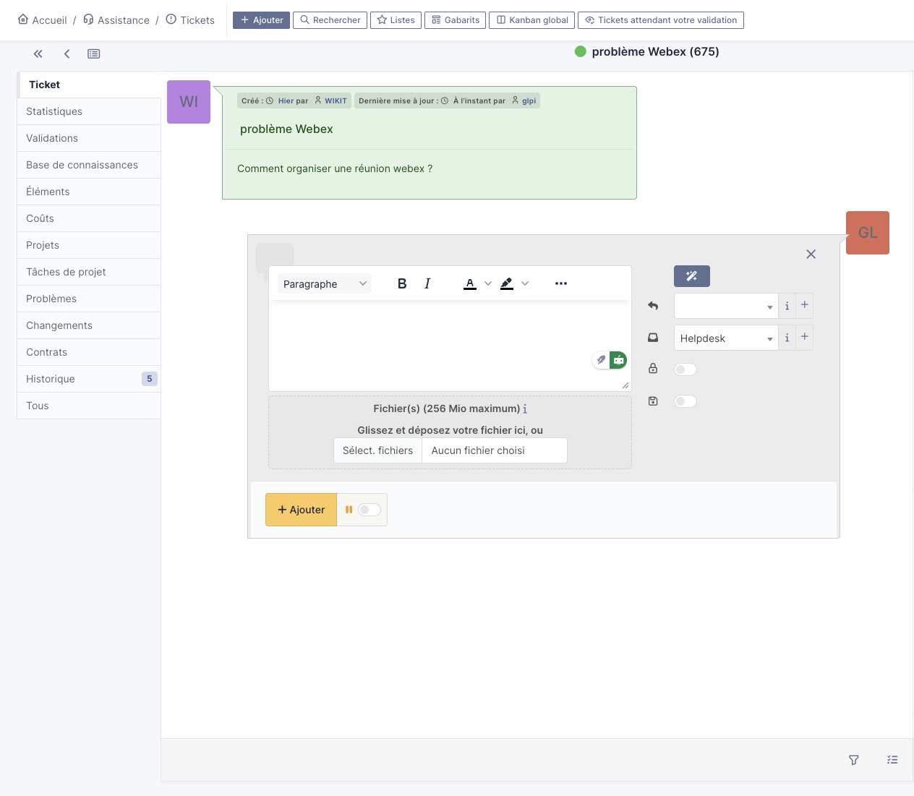
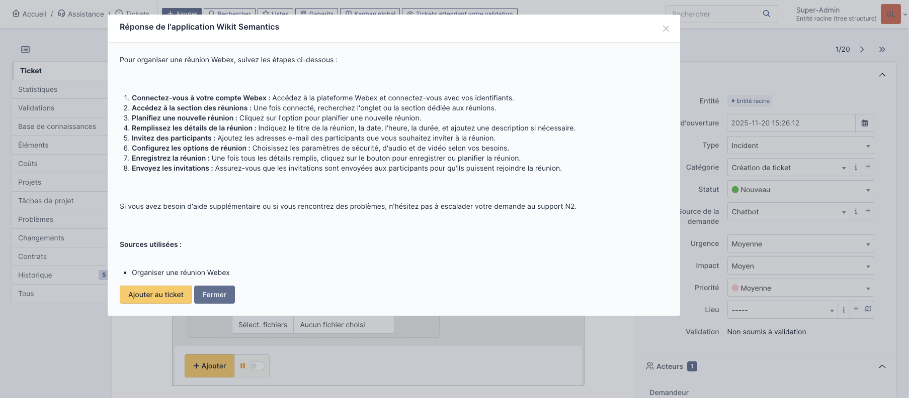

# Wikit Semantics Plugin for GLPI

## Overview

The **Wikit Semantics** plugin brings AI-powered semantic search and intelligent question-answering capabilities to your GLPI installation. By connecting your GLPI instance to the Wikit Semantics API, you can leverage advanced natural language processing to help users get answers quickly for tickets.

## What Does It Do?

This plugin enables users to find in natural language a answer to tickets, context-aware answers based on your organization's knowledge base. Instead of manually searching through tickets, documentation, or FAQ entries, users can simply find solutions and get immediate, relevant responses.

### Key Benefits

- **Faster Support Resolution**: Get instant answers to common questions without waiting for human intervention
- **Knowledge Base Enhancement**: Leverage AI to make your existing GLPI data more accessible and useful
- **Seamless Integration**: Works directly within your GLPI interface - no need to switch between applications

## Features

- Direct integration with Wikit Semantics API
- Secure API authentication with organization and application-level controls
- Easy configuration through GLPI's admin interface
- Connection testing to verify API setup
- Support for GLPI 10.0+ and 11.0+
- Real-time streaming responses (GLPI 11+)
- Multiple integration points: Followups, Solutions, and Tasks
- Answer suggestions based on the whole public conversation of the ticket (private followups and tasks are never sent)
- Classic and workflow Wikit Semantics applications: the Application IDs are entered the same way, the type of each application is detected on the first call and kept in the GLPI cache (quoted sources are only available for classic applications)
- Knowledge Base articles generated from tickets
- Editor AI assistant (correction, formatting, translation): magic wand in the rich text editors

## Screenshots

### Configuration Interface



### Integration with GLPI Forms





## Requirements

### Version Compatibility

| Plugin Version | GLPI Version | PHP Version | Branch | Status |
|---------------|--------------|-------------|--------|--------|
| 1.x.x | 10.0.0 - 10.9.99 | 8.0+ | `1.x` | Maintenance only |
| 2.x.x | 11.0.0+ | 8.2+ | `2.x` | Active development |

**Important**:
- For **GLPI 10.x**, use version 1.x of this plugin
- For **GLPI 11.x**, use version 2.x of this plugin
- Versions are not cross-compatible

### Prerequisites

- Active Wikit Semantics account with:
  - API URL
  - Organization ID
  - Application ID
  - API Key

## Installation

1. Download the archive of the version matching your GLPI version from the
   [GitHub releases](https://github.com/wikit-ai/GLPI-Semantics/releases), e.g. `wikitsemantics-2.2.0.tar.bz2` for GLPI 11
2. Extract it in the `plugins/` directory of GLPI (the folder must be named `wikitsemantics`):
   ```bash
   cd /path/to/glpi/plugins
   tar -xjf wikitsemantics-2.2.0.tar.bz2
   ```
3. Go to **Setup > Plugins**, then **Install** and **Activate** *Wikit Semantics*
4. Open the plugin configuration (**Setup > Plugins > Wikit Semantics**) and enter your credentials
5. Click **Test connection**: one message is displayed for each enabled feature

### Upgrading

Replace the `wikitsemantics` folder with the new version, then click **Update** in **Setup > Plugins**
(or run `php bin/console plugin:install --force wikitsemantics`). The configuration is kept.
Ask the users to reload their GLPI pages so that their browser loads the new JavaScript.

## Configuration

| Setting | Description |
|---------|-------------|
| Wikit Semantics URL base | `https://apis.wikit.ai` for the Wikit cloud (HTTPS only) |
| Organization ID | Your Wikit Semantics organization |
| API key | Stored encrypted with the GLPI key, never displayed again |
| Enable Streaming Mode | Answers displayed token by token |
| Application ID (Answer) | Application used by the ticket answer suggestion |
| Enable Knowledge Base generation / Application ID (Knowledge Base) | Knowledge Base article generation from tickets |
| Enable Editor AI assistant / Application ID (Editor AI) | Correction, formatting and translation in the rich text editors |

### Classic and workflow applications

The Application IDs of classic applications (`/semantics/` API) and of workflow applications
(`/semantics-workflow/` API) are entered the same way. The type of an application cannot be read
with an API key: on the first call, the plugin calls the classic API, then the workflow API when the
classic one fails (the classic API answers with an error 500 for a workflow application). The type
that answers is kept in the GLPI cache for 24 hours, so the next calls go directly to the right API.
An application that changes of type is detected again automatically.

Quoted sources (**Sources** button) are only available for classic applications.

### Context sent for the answer suggestion

The whole public conversation of the ticket is sent to the application: title, description, then the
followups, tasks and solutions in chronological order, with their author and date. **Private followups
and tasks are never sent**, so that internal notes cannot end up in an answer to the requester. Beyond
20,000 characters, the oldest messages are omitted (the title and the description are always kept).

### Rights

Configured in **Administration > Profiles > Wikit Semantics**:

| Right | Read | Update |
|-------|------|--------|
| Wikit Semantics - Configuration | Answer suggestion button | Plugin configuration |
| Wikit Semantics - Knowledge Base | Knowledge Base tab on tickets | Article creation |
| Wikit Semantics - Editor AI | Editor AI assistant | - |

## Troubleshooting

The calls to Wikit Semantics are logged in `files/_log/wikitsemantics.log` (GLPI log directory):

- `WARNING` / `ERROR`: failed calls, with the HTTP code and the URL
- `INFO ... trying the other API (classic or workflow)`: expected once a day for a workflow application,
  while its type is detected
- `DEBUG`: each successful call, written in the GLPI debug mode only

If the connection test fails for an application, check its ID and that the API key belongs to the
organization; the HTTP code in the log tells which API refused the call.

## About Wikit Semantics

Wikit Semantics provides enterprise-grade AI solutions for intelligent information retrieval and knowledge management. Visit [Wikit](https://wikit.ai) for more information.

## Contributing

* Open a ticket for each bug/feature so it can be discussed
* Work on a new branch on your own fork
* Open a PR that will be reviewed by a developer

## License

This plugin is licensed under the Apache 2.0 License.

## Support

For issues, questions, or contributions, please visit our [GitHub repository](https://github.com/wikit-ai/GLPI-Semantics).

---


**Copyright**: © 2026 Wikit
